# Chip Supply Chain

**[chipsupplychain.org](https://chipsupplychain.org)** is a free, sourced introduction to how AI chips are made and who controls each step.

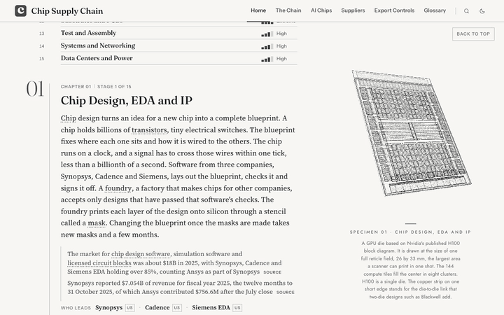

## What's on the site

- **The Chain.** Sixteen chapters. Fourteen follow one accelerator through the supply chain, from design software and silicon wafers through lithography, fabrication, memory and packaging to the rack and the data center. Two more look across the whole chain, at the economics of AI chips and at who controls the chain.
- **In every chapter.** A 3D specimen beside the text, a chokepoint card that rates the stage, charts and animations, flashcards, and a PDF to download. Every number links to its source.
- **Export Controls.** The main rules since 2018 from the US, China, Japan, the Netherlands, the EU and others, what can still be sold to China on any date, and China's share of revenue at 24 firms.
- **Suppliers.** 226 firms on a map and by stage, with the latest revenue for 170 of them, as filed and in US dollars.
- **AI Chips.** 38 chips compared side by side, from the A100 of 2020 to the parts shipping in 2026.
- **Glossary.** Every term, firm, chip and country, with the passages that use them.
- **PDFs.** Each chapter on its own, the whole chain as a book, and a four-page summary.

## A look inside

### A chapter
Each chapter opens with its stage in the left column, a plain summary, and the specimen at the right.

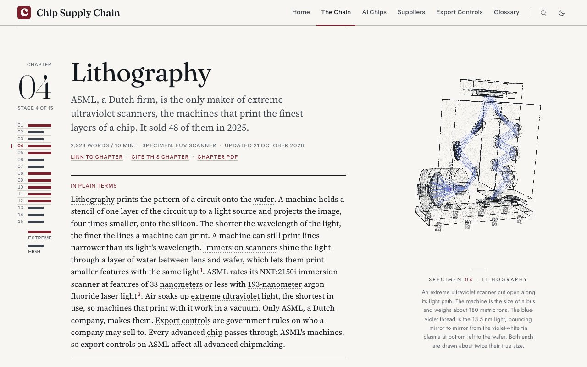

### The chokepoint card
How concentrated the stage is, how hard it would be to replace, what it costs, who leads and where it is made.

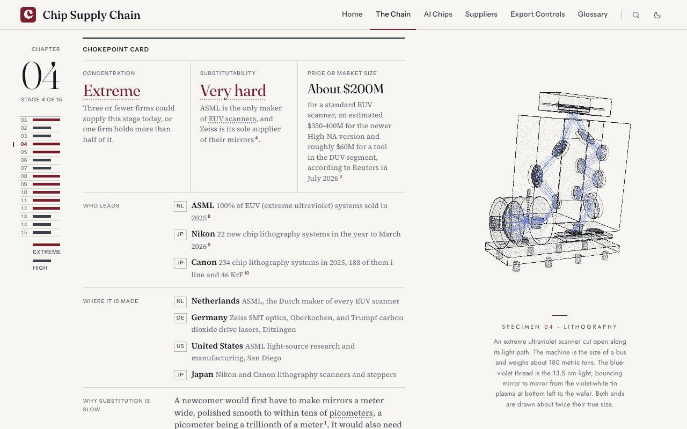

### Charts and animations
Charts put red on the largest figure. Animations show how a step works.

  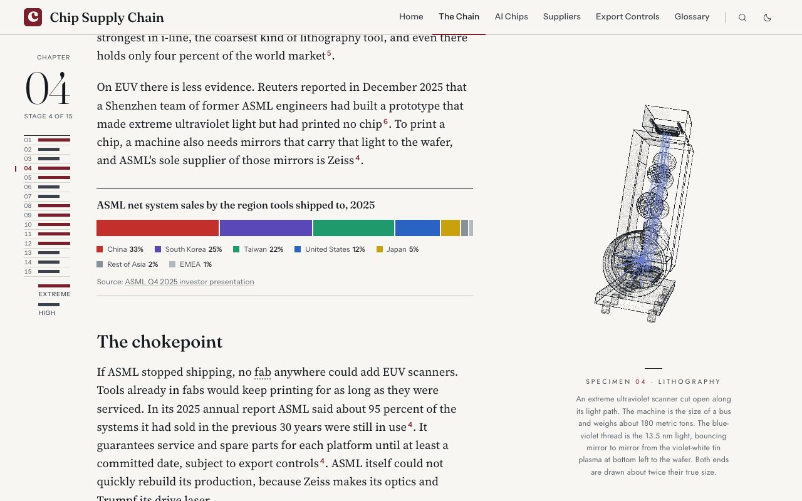
  

### Suppliers
Where the 226 firms sit, and which countries supply which stages. Red marks the firms rated Critical.

  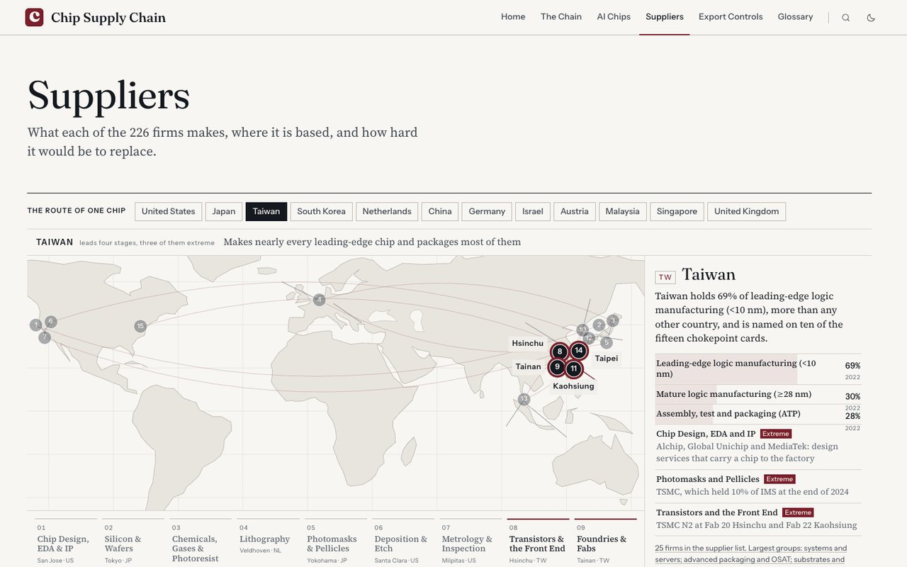
  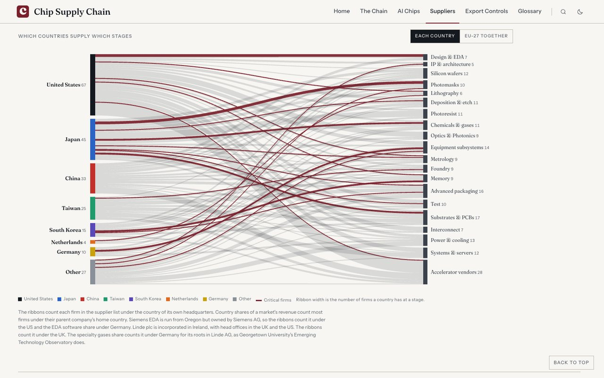

### Export Controls
The board shows what can be sold to China on any date. Each panel shows China's share of a firm's revenue, year by year, from its filings.

  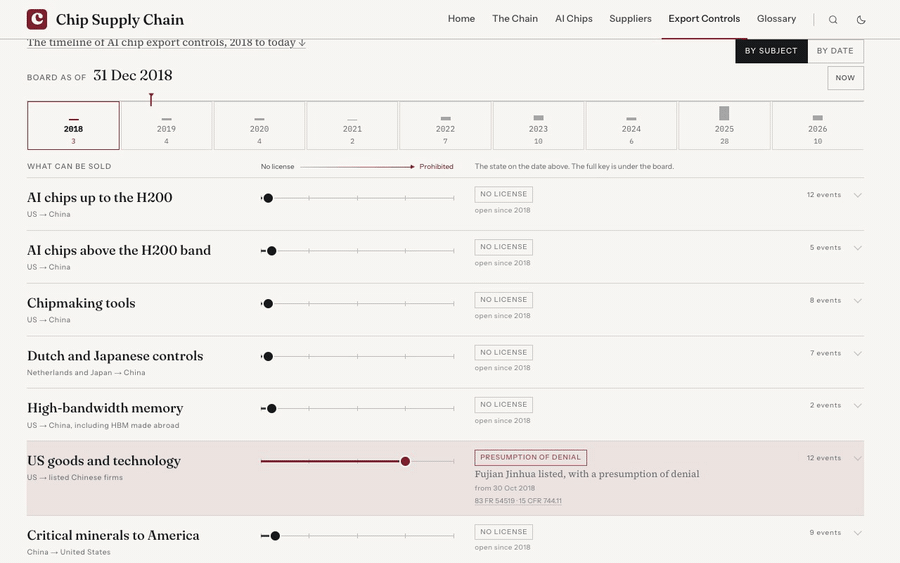
  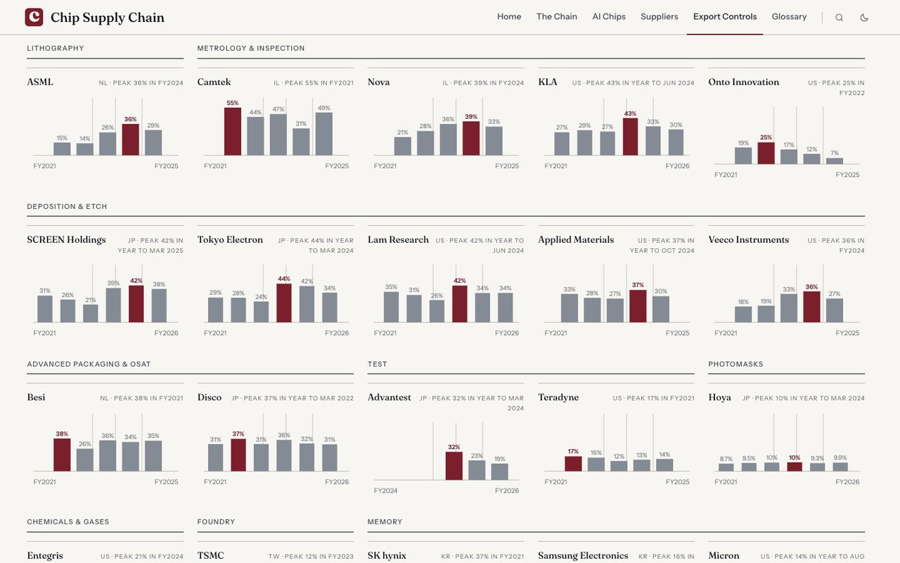

### Glossary
A firm's card gives what it makes, where it is based and its revenue, and for 24 firms China's share of it.

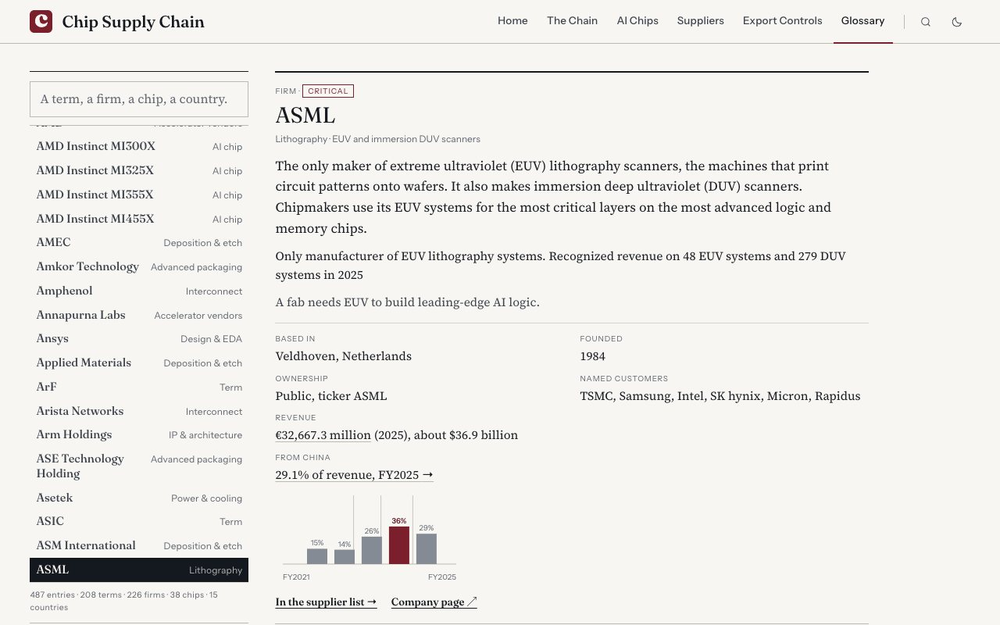

### PDFs and phones

  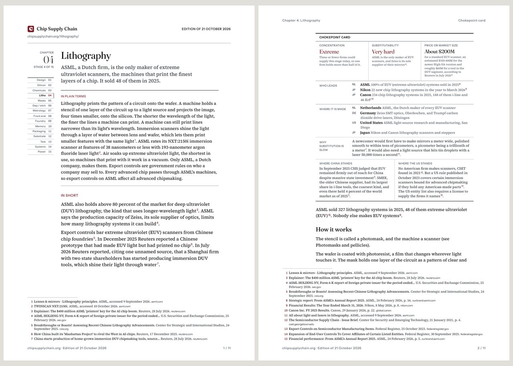
  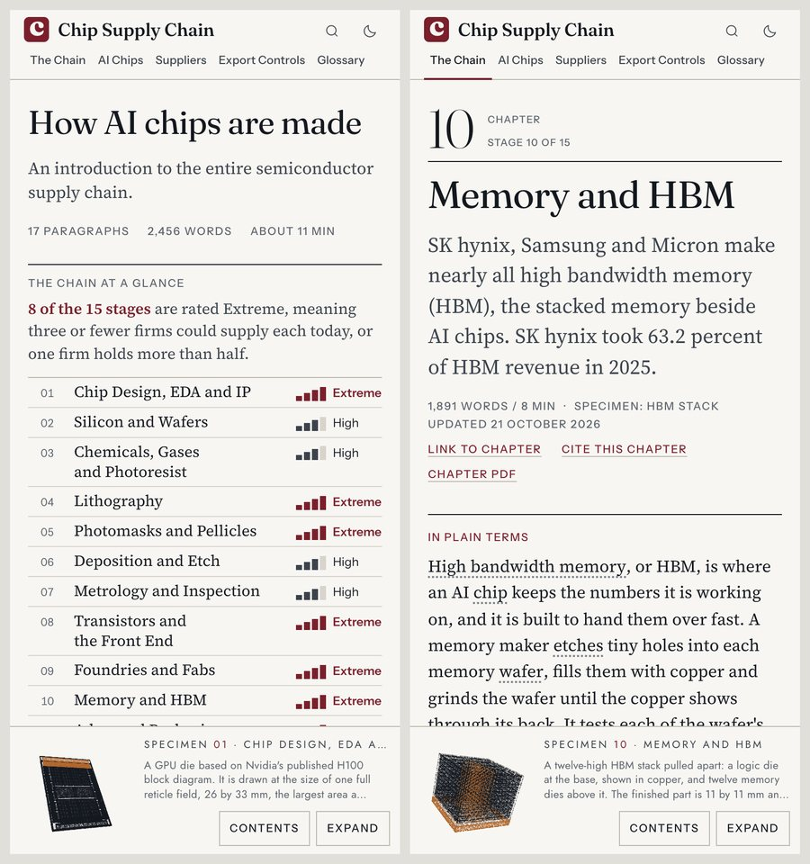

## How it is sourced

- **Where the numbers come from.** Company filings, governments and regulators, standards and industry bodies, universities and research institutes, plus Reuters, the Financial Times, Nikkei and SemiAnalysis.
- **Every figure is dated** and links to the page it comes from, in 2,721 citations.
- **Revenue in another currency** is shown as filed, then converted at the Federal Reserve's average rate for that fiscal year.
- **A check in the build** fails any citation from a source outside the policy.

## Visit the site

**[chipsupplychain.org](https://chipsupplychain.org)**

## Credits

Made by Yashvardhan Sharma with Claude. Corrections and questions: contact@chipsupplychain.org.
